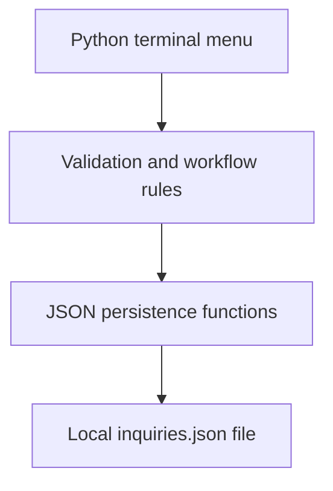

# Bench & Bolt — Group Customer Studio Plan

Team: Megha Patel and Ana Sanchez. Stage: Review 1 — Plan.

Status: Planning decisions confirmed by Megha in this conversation on behalf of the team. Ana confirmed the selected scope, four stories, Python-only approach, and responsibilities. Real cross-review is confirmed.  Both members confirmed the scope and responsibilities. Specific review feedback, linked changes, and reviewer verification is confirmed. This is a fictional customer scenario from the instructor kit, not a real business interview.

Shared repository: pending creation. Customer agreement: [customer-kit/CUSTOMER-NOTES.md](customer-kit/CUSTOMER-NOTES.md). Keep this one SPEC.md as the evolving shared record.

## Customer, audience, and useful promise

Maya Chen runs the fictional Bench & Bolt bike-repair shop. Repair inquiries arrive in scattered notes and messages. The user is a trusted shop coordinator. We will build a local Python terminal program that records an inquiry, displays it in a queue, permits valid status changes, and retains it after restart. It will run on one staff-operated computer, not on a public website.

## Two scopes and decision

| Option | Workflow | Tradeoff |
| --- | --- | --- |
| A: Staff intake — selected | Coordinator enters an inquiry, reviews the queue, and updates status. | One operating role and a smaller interface; riders cannot submit directly. |
| B: Rider intake | Riders submit inquiries through a separate interface; coordinator reviews them. | Adds an intake interface and, if public, server-side authentication/permissions. |

We chose A to finish one small stored workflow with fewer interfaces. Python-only means Python standard-library modules, including json and unittest; no Flask, database server, or web interface. JSON is a storage format, not a separate service. A later public version would require a new security design and server-enforced coordinator permissions.

## Four agreed stories and planned acceptance checks

| ID | Story | Success check — planned | Failure check — planned |
| --- | --- | --- | --- |
| G1 | As coordinator, I want to enter an inquiry so it is recorded. | A valid inquiry gets a unique ID, creation order, and Pending review status. | Blank problem, unsupported bike type, or overlong input creates no record. |
| G2 | As coordinator, I want to view the queue so I can find inquiries. | Saved fields and IDs appear accurately, including after application restart. | Unknown inquiry ID shows a useful message without changing records. |
| G3 | As coordinator, I want to update status so I can track progress. | Pending review can become Accepted or Declined; Accepted can become Completed. | Pending review cannot become Completed; terminal records cannot be changed. Rejected actions do not alter saved data. |
| G4 | As coordinator, I want consistent details and a clear next step. | Queue and detail view show the same saved status. Preferred day remains a preference. | No view claims that a requested day is booked, a payment occurred, or a repair is complete before its status is Completed. |

## Data and validation rules

| Field | Rule |
| --- | --- |
| id | Generated unique positive integer; retain across restart and do not reuse. |
| rider_label | Synthetic rider label only; no real contact information. |
| bike_type | city, road, or other. |
| problem | 1–240 characters after trimming; nonblank. |
| preferred_day | Optional text, at most 40 characters; not a booking. |
| status | Exactly Pending review, Accepted, Declined, or Completed. |
| creation_order | Generated increasing value, persisted with the record. |

Proposed implementation detail: keep next_id and an inquiries list in data/inquiries.json. Maintain IDs even if the queue is empty. Store the file path relative to the project, not the terminal's current folder. No delete-inquiry feature is planned.

## Status rules

| Current state | Allowed next state | Meaning |
| --- | --- | --- |
| New valid inquiry | Pending review | Stored and waiting for review. |
| Pending review | Accepted | Shop agrees to take the job; no time is reserved and no charge occurs. |
| Pending review | Declined | Shop will not take the job; terminal state. |
| Accepted | Completed | Work recorded as finished; terminal state. |
| Completed or Declined | None | Further transitions rejected. |

Reject all unlisted transitions without changing memory or the saved file. Failed saves must not be reported as successful updates.

## Small workflow

Start → load JSON → show menu → add/view/find/update → validate → save successful mutation → show honest confirmation → return to menu → exit.

Menu: Add inquiry; View queue; View details by ID; Update status; Exit. Empty queue displays No inquiries yet. Unsupported menu choices prompt again. Missing JSON file starts an empty queue. Corrupt JSON or a write failure produces an error and must not silently overwrite existing data. Single-process local use only; concurrent edits are outside the promise. Use a temporary file and replacement for a completed save; test failure behavior later.### Planned error messages and recovery

If the JSON file is damaged, display:
“Saved inquiries could not be read. No data was changed. Restore a valid file before continuing.”
Stop without overwriting the file.

If saving fails, display:
“The inquiry could not be saved. Existing records were preserved. Check file access and try again.”
Do not show a success message or keep the unsaved change in memory.

These behaviors are planned; runtime checks have not been run.

## Architecture sketch and proposed files

| Planned file | Responsibility |
| --- | --- |
| main.py | Menu, prompts, messages, and calling workflow functions. |
| inquiries.py | Validate new inquiries and create records. |
| workflow.py | Apply allowed status transitions without changing invalid records. |
| storage.py | Load and safely save JSON records. |
| tests/ | unittest validation, transition, persistence, and integrated workflow checks using temporary files. |

Files are planned, not implemented. Run command after implementation: python3 main.py. Planned test command: python3 -m unittest discover -s tests -v. Python version will be recorded from the actual machine when executed.

## Pattern experiment — planned

Compare repeated status conditionals against a small transition dictionary. Use the same allowed/rejected state pairs. Compare clarity, duplicated rules, and ease of testing. Try both before choosing; a dictionary is not automatically better. Keep the simpler solution if it is clearer. No pattern experiment has been run.

## Member work and cross-review

| Member | Design | Development | QA and cross-review |
| --- | --- | --- | --- |
| Megha Patel | Intake prompts, validation messages, and success/error states. | Inquiry validation and creation, including menu integration. | Write valid/invalid intake tests; review Ana's queue, transitions, and restart results. |
| Ana Sanchez | Queue/detail layout and status feedback. | Queue/detail functions, JSON persistence, and status updates. | Write transition and persistence tests; review Megha's form-equivalent terminal prompts and invalid-input behavior. |
| Both | Agree interfaces and synthetic fixtures. | Integrate early and review the storage contract. | Try the full path, explain personal work, and record real issues and retries. |

Compare actual effort as work begins; rebalance if persistence makes Ana's slice substantially larger. Commit count is not a measure of equal contribution. Actual commits and review evidence remain pending.

## Planned independent checks

Synthetic fixture: rider TEST-001, bike city, problem Brake rubbing, preferred day Monday. Expected initial status: Pending review. Verify exact values and unchanged ID after restart. Accept then complete and restart again. Separately attempt Pending review → Completed, Declined → Accepted, and Completed → Accepted: each must fail without mutation. Test 240/241-character problems, 40/41-character preferred days, whitespace-only problem, unsupported bike type, missing file, invalid JSON, and failed saves. Queue and detail must agree. All checks are NOT RUN.

## Real peer task and evidence

Plan-stage task: ask a real classmate to locate the selected scope, explain one rejected transition, and identify each member's responsibility. Record specific observations in GitHub issues. Decide implement/investigate/defer/decline with a reason, link accepted changes, verify, and ask the reviewer to retry before closing. Later, ask them to create TEST-001, accept and complete it, attempt a rejected transition, and inspect restart persistence without coaching.

Reviewer/date/revision: pending. Issue, change, check, and retry links: pending. The individual Expense Logger review does not automatically demonstrate review of this group plan.

## AI assistance, current checks, and next

ChatGPT helped Megha to record this. It did not impersonate Ana or a real reviewer. The simulation can establish fictional business scope, not technical verification. Initial expectation: a manageable local workflow. Observed result: an agreed planning direction and written checks, not running software. Next time: define expected results independently before using AI to suggest implementation.

Observed preparation: supplied scenario inspected, four stories and allowed states compared with its facts, and planning files prepared. Not run: program, automated tests, persistence, real human review, and CI. Keep those labels until evidence exists.

Next: share this plan with Ana, create/use one shared group repository, obtain actual member confirmation and plan feedback, update links, and implement the later first slice. The kit's bounded later change and final acceptance have not been requested or completed. Check the course schedule before adding later scope.
